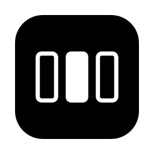
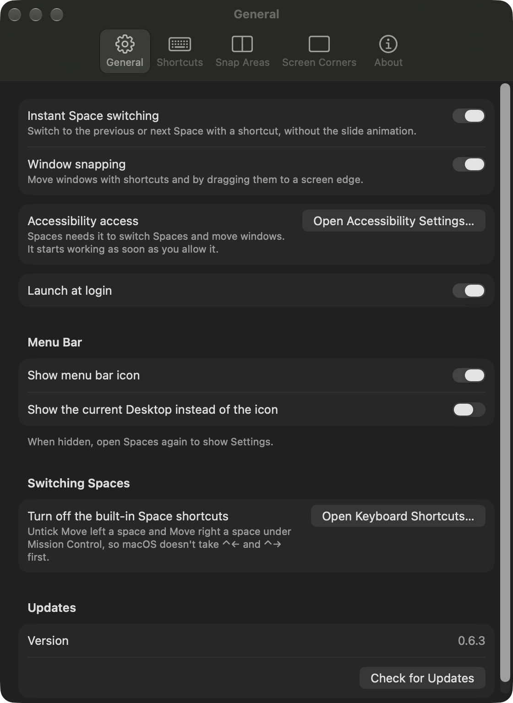

<div align="center">



# Spaces

**Switch Spaces instantly. Snap windows into place.**

A menu bar app that drops the slide animation and tiles windows with a shortcut or a drag.

[Download](https://github.com/gustaferiksson/spaces/releases/latest) · [Install with Homebrew](#install) · Requires macOS 27 on Apple silicon

</div>

<p align="center">
  
</p>

## What it does

Press ⌃← or ⌃→ and you're on the next Desktop at once, with a glass pill showing which one you landed on. No slide, no waiting. Spaces also moves windows to halves, thirds and corners, from the keyboard or by dragging them to a screen edge.

| | |
|---|---|
| **Space switching** | **⌃← / ⌃→** switch Spaces without the slide animation. Switching stops at the first and last Space instead of bouncing, and with several displays it follows the display under the pointer. |
| **Halves** | **⌃⌥← / ⌃⌥→** put the window on the left or right half. Press again to cycle through ½, ⅔ and ⅓ of the screen. |
| **Maximize** | **⌃⌥↩** maximizes the window. Press it again to restore the previous size. |
| **Thirds** | First, center and last third, and first or last two thirds. These have no shortcut until you set one. |
| **Control Center** | **⌃⌥⌘C** opens Control Center. Press it again to close. |
| **Snap areas** | Drag a window to a screen edge or corner and a translucent preview shows where it will land. Each edge and corner's action is set in Settings. Drag a snapped window away and it returns to its earlier size. |
| **Screen corners** | Opt in under Settings › Screen Corners to round your displays with click-through black overlays, sized automatically for each display. Choose a size preset, continuous or circular curves, and individual corners. |
| **Updates** | Checks GitHub Releases and installs new versions in place. |

All shortcuts can be changed in Settings › Shortcuts. Space switching and window snapping can each be turned off in Settings or the menu bar menu.

## Install

```sh
brew install --cask gustaferiksson/tap/spaces
```

Or download `Spaces-<version>.zip` from the [latest release](https://github.com/gustaferiksson/spaces/releases/latest) and move `Spaces.app` to `/Applications`.

## Set up

1. Allow **Spaces** in System Settings › Privacy & Security › Accessibility.
2. Untick **Move left a space** and **Move right a space** in System Settings › Keyboard › Keyboard Shortcuts › Mission Control, so macOS doesn't take ⌃←/→ first.
3. If you use snap areas, turn off **Drag windows to screen edges to tile** in System Settings › Desktop & Dock, so macOS doesn't tile the same drag.

<details>
<summary><b>Moving from the <code>spaces</code> command-line tool</b></summary>

<br>

```sh
brew services stop spaces
brew uninstall --formula spaces
```

Then remove the old `spaces` entry from the Accessibility list and allow Spaces.app instead. The grant doesn't carry over.

</details>

<details>
<summary><b>URL scheme</b></summary>

<br>

Every shortcut action can also be triggered with a URL, for example from a mouse button:

```sh
open -g spaces://left-half
```

Actions: `previous-space`, `next-space`, `control-center`, `left-half`, `right-half`, `maximize`, `first-third`, `center-third`, `last-third`, `first-two-thirds`, `last-two-thirds`.

</details>

<details>
<summary><b>How it works</b></summary>

<br>

Space switching posts a synthetic Dock swipe, the same kind of event a three-finger trackpad swipe produces, with almost no travel and a high release velocity. The Dock commits the switch with nothing left to animate. macOS 27 also checks that the swipe carries a serialized trackpad (IOHID) record, so one is attached. The approach follows [noswoosh](https://github.com/mmathys/noswoosh), which documents it in depth. It relies on undocumented event fields and a private SkyLight call (to know which Space you're on), so a macOS update can break it.

The Dock ignores the swipe while a window is being dragged, so then Spaces briefly turns on macOS's own "Move left/right a space" shortcut and presses it for you, which carries the window along. It's switched back off when you let go of the mouse.

Windows are moved through the Accessibility API.

</details>

<details>
<summary><b>Building from source</b></summary>

<br>

You need Xcode, [XcodeGen](https://github.com/yonaskolb/XcodeGen) and `rsvg-convert` (`brew install xcodegen librsvg`).

```sh
./build.sh                                        # dist/Spaces.app, ad hoc signed unless .env sets a team
swift test --package-path Packages/SpacesCore     # tests
```

An ad hoc build gets a new code identity every time, so Accessibility has to be granted again after each build. Copy `.env.example` to `.env` and set your team and signing identity to build signed. Releases are tagged and built by GitHub Actions, see [docs/RELEASING.md](docs/RELEASING.md).

</details>

## License

[MIT](LICENSE).
